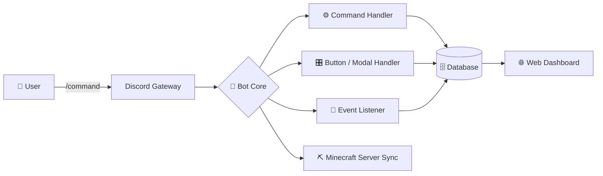

<div align="center">


<br/>


<br/><br/>


</div>

<br/>

```
██╗     ██╗███████╗███████╗███████╗████████╗██╗   ██╗██╗     ███████╗
██║     ██║██╔════╝██╔════╝██╔════╝╚══██╔══╝╚██╗ ██╔╝██║     ██╔════╝
██║     ██║█████╗  █████╗  ███████╗   ██║    ╚████╔╝ ██║     █████╗
██║     ██║██╔══╝  ██╔══╝  ╚════██║   ██║     ╚██╔╝  ██║     ██╔══╝
███████╗██║██║     ███████╗███████║   ██║      ██║   ███████╗███████╗
╚══════╝╚═╝╚═╝     ╚══════╝╚══════╝   ╚═╝      ╚═╝   ╚══════╝╚══════╝
                    ██████╗  ██████╗  ██████╗  ██████╗
                    ╚════██╗██╔═████╗██╔═████╗██╔═████╗
                     █████╔╝██║██╔██║██║██╔██║██║██╔██║
                    ██╔═══╝ ████╔╝██║████╔╝██║████╔╝██║
                    ███████╗╚██████╔╝╚██████╔╝╚██████╔╝
                    ╚══════╝ ╚═════╝  ╚═════╝  ╚═════╝
```


## 🖥️ `neofetch --lifestyle_2000`

```yaml
╭──────────────────────────────────────────────────────────╮
│  user@Lifestyle_2000                                     │
│  ──────────────────────────────────────────────────────  │
│  OS        : Brain v2000 (caffeine-powered)              │
│  Role      : Discord Bot & Minecraft Developer           │
│  Languages : Java · Python · HTML · CSS                  │
│  Bots      : Slash cmds · Buttons · Modals · Dashboards  │
│  Minecraft : Plugins · Mods · Custom GUIs · Mechanics    │
│  Editor    : IntelliJ IDEA / PyCharm / VS Code           │
│  Uptime    : 24/7 (bots never sleep)                     │
│  Bugs      : 0 (they're called "features")               │
│  Mood      : 🔥 Shipping                                 │
╰──────────────────────────────────────────────────────────╯
```


## ⚔️ Player Stats

```diff
+ ☕ JAVA ..................... ██████████████████░░  92%
+ 🐍 PYTHON .................. █████████████████░░░  88%
+ 🤖 DISCORD BOTS ............ ███████████████████░  96%
+ ⛏️ MINECRAFT PLUGINS ....... ███████████████████░  95%
+ 🧩 MINECRAFT MODS .......... █████████████████░░░  86%
+ 🌐 HTML ..................... ███████████████░░░░░  78%
+ 🎨 CSS ...................... ██████████████░░░░░░  72%
- 😴 SLEEP .................... ██░░░░░░░░░░░░░░░░░░  10%
```

<div align="center">

### 🧰 Arsenal


</div>

<details>
<summary><b>🔧 Full tech inventory (click to open)</b></summary>
<br/>

| ⚔️ Category | 🛡️ Tech |
|:--|:--|
| 🤖 **Discord (Java)** | JDA · Javacord · Discord4J |
| 🐍 **Discord (Python)** | discord.py · py-cord · nextcord · disnake |
| ⛏️ **Plugins** | Spigot · Paper · Bukkit · Velocity · BungeeCord |
| 🧩 **Mods** | Fabric · Forge · NeoForge · Mixin |
| 🗄️ **Data** | SQLite · MySQL / MariaDB · MongoDB · HikariCP |
| 🌐 **Frontend** | HTML5 · CSS3 · responsive dashboards |
| 📦 **Build** | Gradle · Maven |
| 🔌 **APIs** | REST · Webhooks · JSON · Gateway events |

</details>


## 🧬 Bot Architecture



## 🏆 Achievements Unlocked

| | Achievement | Status |
|:-:|:--|:-:|
| 🤖 | **Bot Builder** – shipped fully featured Discord bots | ✅ |
| ⛏️ | **Block Breaker** – built custom Minecraft plugins | ✅ |
| 🧩 | **Mod Maker** – coded Minecraft mods | ✅ |
| 🌐 | **Pixel Perfect** – designed dashboards in HTML & CSS | ✅ |
| 🧠 | **Polyglot** – fluent in Java *and* Python | ✅ |
| 👑 | **Final Boss** – ??? | 🔒 *coming soon* |


## 🖼️ Showcase

<div align="center">

**🤖 Discord Bot**


<br/><br/>

**⛏️ Minecraft Plugin GUI**


<br/><br/>

**🌐 Web Dashboard**


</div>


## 💻 Code Arena

<details open>
<summary><b>🤖 Discord Slash Command — JDA (Java)</b></summary>

```java
public class PingCommand extends ListenerAdapter {

    @Override
    public void onSlashCommandInteraction(SlashCommandInteractionEvent event) {
        if (!event.getName().equals("ping")) return;

        long start = System.currentTimeMillis();
        event.reply("🏓 Pong!").setEphemeral(true).queue(hook ->
            hook.editOriginal("🏓 Pong! `" + (System.currentTimeMillis() - start) + "ms`").queue()
        );
    }
}
```
</details>

<details>
<summary><b>🐍 Discord Slash Command — discord.py (Python)</b></summary>

```python
import discord
from discord import app_commands

class Bot(discord.Client):
    def __init__(self):
        super().__init__(intents=discord.Intents.default())
        self.tree = app_commands.CommandTree(self)

    async def setup_hook(self):
        await self.tree.sync()

bot = Bot()

@bot.tree.command(name="ping", description="Check the bot latency")
async def ping(interaction: discord.Interaction):
    await interaction.response.send_message(
        f"🏓 Pong! `{round(bot.latency * 1000)}ms`", ephemeral=True
    )
```
</details>

<details>
<summary><b>⛏️ Minecraft Command — Paper (Java)</b></summary>

```java
public class HealCommand implements CommandExecutor {

    @Override
    public boolean onCommand(CommandSender sender, Command cmd, String label, String[] args) {
        if (!(sender instanceof Player player)) {
            sender.sendMessage("§cOnly players can use this!");
            return true;
        }
        if (!player.hasPermission("lifestyle.heal")) {
            player.sendMessage("§cNo permission.");
            return true;
        }
        player.setHealth(player.getMaxHealth());
        player.setFoodLevel(20);
        player.sendMessage("§a✔ Healed by Lifestyle_2000!");
        return true;
    }
}
```
</details>

<details>
<summary><b>🌐 Neon CSS Button (HTML/CSS)</b></summary>

```html
<button class="neon">Invite Bot</button>

<style>
  .neon {
    padding: 14px 36px;
    font: 700 18px 'Fira Code', monospace;
    color: #00f7ff;
    background: transparent;
    border: 2px solid #00f7ff;
    border-radius: 12px;
    box-shadow: 0 0 10px #00f7ff, inset 0 0 10px #00f7ff55;
    transition: .3s;
    cursor: pointer;
  }
  .neon:hover {
    background: #00f7ff;
    color: #0d1117;
    box-shadow: 0 0 30px #00f7ff;
  }
</style>
```
</details>


## 📊 GitHub Analytics

<div align="center">


<br/>


<br/>


<br/>


</div>


## 🎯 Mission Log

```json
{
  "currentQuest":   "Building the next big Discord bot",
  "sideQuest":      "Minecraft plugin & mod experiments",
  "learning":       ["Kotlin", "TypeScript", "Rust"],
  "openFor":        ["Commissions", "Collabs", "Open Source"],
  "contact":        "DM on Discord",
  "motto":          "Code. Ship. Repeat."
}
```

## 💼 Commissions

<div align="center">

| 🤖 Custom Discord Bots | ⛏️ Minecraft Plugins | 🧩 Minecraft Mods | 🌐 Dashboards |
|:-:|:-:|:-:|:-:|
| Moderation, tickets, economy, music, custom systems | GUIs, minigames, economy, custom mechanics | Fabric / Forge content & features | Clean HTML/CSS web interfaces |

**📩 Interested? Just send me a DM on Discord.**

</div>


<div align="center">

```
while (true) {
    code();
    ship();
    repeat();
}
```


</div>
